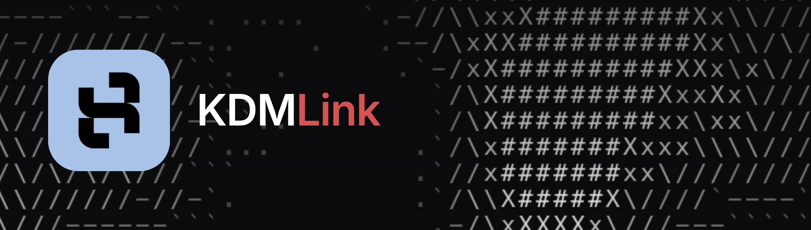

<p align="center">
  
</p>

# KDMLink

Open standards for KDMLink: **how to decode Hyundai N CAN traffic** and **how to talk to KDMLink hardware**.

| | What | Where |
|---|------|-------|
| 🚗 | **Vehicle data**: which CAN ID, which bits and what scaling turn raw C-CAN traffic into RPM, boost, gear, fuel level, tire pressures, N Mode settings and more | [`vehicles/`](vehicles) · [format](docs/FORMAT.md) |
| 📡 | **BLE protocol**: discovery, pairing, the telemetry stream, commands and OTA for the KDMLink device | [`protocol/BLE.md`](protocol/BLE.md) |

The KDMLink device is a transparent pipe: it streams raw CAN frames over BLE and does no decoding itself. The [KDMLink app](https://www.kdmlink.com) decodes those frames with the JSON in this repo, so an improvement merged here reaches every KDMLink user with the next vehicle data release. The same two documents are everything you need to build your own app, logger or dashboard on top of KDMLink hardware.

## Supported vehicles

| Vehicle | Years | Transmissions | Status |
|---------|-------|---------------|--------|
| Hyundai Veloster N | 2019–2022 | MT, DCT | Stable |
| Hyundai Elantra N | 2022–2026 | MT, DCT | Experimental |
| Hyundai Kona N | 2022–2023 | DCT | Stable |

## Vehicle data layout

```
vehicles/
  manifest.json                         # every supported vehicle
  common.json                           # signals shared by all cars
  hyundai/
    veloster_n/
      base.json                         # shared by all Veloster N
      2019-2022/
        base.json                       # shared by this year range
        manual.json                     # leaf: one concrete vehicle (has id + version)
        dct.json
```

A vehicle like `hyundai.veloster_n.2019-2022.dct` is built by stacking layers from general to specific:

```
common.json → hyundai/common.json → veloster_n/base.json → 2019-2022/base.json → 2019-2022/dct.json
```

A later layer overrides a signal with the same `name` + `canId`, and can drop inherited ones with `removeSignals`. See [docs/FORMAT.md](docs/FORMAT.md) for every field.

## Tools

Requires Node 20+. There are no dependencies to install.

```bash
node scripts/validate.mjs                                   # check everything (CI runs this)
node scripts/decode.mjs --list hyundai.kona_n.2022-2023.dct # list a car's signals
node scripts/decode.mjs hyundai.kona_n.2022-2023.dct capture.csv --signals EngineRPM,BoostPressurePsi
```

`decode.mjs` reads KDMLink recorder exports, `candump` logs and SavvyCAN CSV. It decodes exactly the way the app does, including dropping samples that fall outside `minValue`/`maxValue`.

## Contributing

Corrections and new signals are very welcome, especially from owners with access to a car. Start with [CONTRIBUTING.md](CONTRIBUTING.md). Open problems where help is needed:

- **Yaw rate** on Veloster N DCT and Kona N: the signed/offset encoding is unconfirmed, so range checking is disabled.
- **2024+ Elantra N fuel level**: facelift cars may use a different sender range than earlier ones.
- **Kia Stinger GT and other platforms**: no configs exist yet.

## License

- Vehicle data and specifications (`vehicles/`, `protocol/`, `docs/`) are licensed under [CC BY-SA 4.0](LICENSE). You can use them in your own projects, including commercial ones, as long as you credit "KDMLink" and share your changes under the same license.
- Tooling (`scripts/`) is licensed under the [MIT License](scripts/LICENSE).

This project is not affiliated with or endorsed by Hyundai Motor Company or Kia Corporation. The definitions were reverse-engineered from broadcast traffic and are provided as-is, without warranty. Don't rely on them for anything safety-critical.
